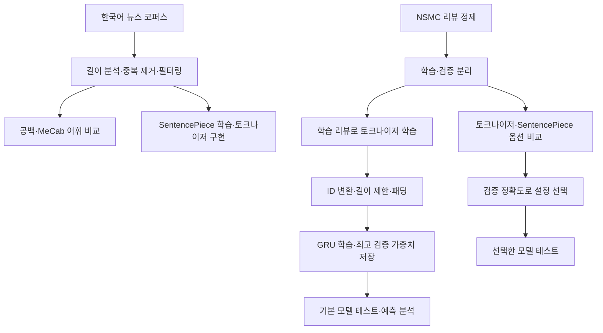

# 01. 멋진 단어사전 만들기 — SentencePiece와 한국어 감정 분석

한국어 코퍼스를 분석하고 토큰화 방법을 비교한다. 직접 학습한 SentencePiece를 PyTorch GRU 분류기에 연결하여 네이버 영화리뷰(NSMC)의 긍정·부정을 예측하고, `model_type`과 `vocab_size` 변경에 따른 성능을 확인한다.

- [프로젝트 노트북](2_%E1%84%86%E1%85%A5%E1%86%BA%E1%84%8C%E1%85%B5%E1%86%AB_%E1%84%83%E1%85%A1%E1%86%AB%E1%84%8B%E1%85%A5%E1%84%89%E1%85%A1%E1%84%8C%E1%85%A5%E1%86%AB_%E1%84%86%E1%85%A1%E1%86%AB%E1%84%83%E1%85%B3%E1%86%AF%E1%84%80%E1%85%B5_%5B%E1%84%91%E1%85%B3%E1%84%85%E1%85%A9%E1%84%8C%E1%85%A6%E1%86%A8%E1%84%90%E1%85%B3%5D.ipynb)
- 기본 SentencePiece + GRU: **테스트 정확도 84.82%**.
- 검증 성능으로 선택한 BPE 8,000 + GRU: **테스트 정확도 84.97%**.

수치는 노트북의 저장된 실행 결과이다. 모델 비교는 동일한 GRU 구조에서 토크나이저를 변경한 것으로, LSTM·CNN 등 분류기 구조 간 비교는 수행하지 않았다.

**Simple English**

We compare Korean tokenizers using the same GRU classifier. The baseline reaches 84.82% test accuracy. The selected BPE model reaches 84.97%.

## 학습 목표와 평가 기준

| 학습 목표 | 평가 기준 | 노트북의 근거 |
| --- | --- | --- |
| SentencePiece 모델 생성 과정 수행 | 코퍼스 분석, 전처리, 토크나이저 학습·구현·동작 확인 | 뉴스 코퍼스 분석, `sp_tokenize()`, NSMC encode/decode 확인 |
| 토크나이저와 분류기 결합 | 정상적인 학습 및 테스트 정확도 80% 이상 | 기본 모델 84.82%, 선택한 BPE 모델 84.97% |
| SentencePiece 성능 다각도 비교 | 다른 토크나이저 및 SentencePiece 옵션과 비교 | MeCab·Okt 비교, `model_type`·`vocab_size` 변경 실험 |

**Simple English**

The goals are to build a tokenizer, use it in a classifier, and compare settings. Both tested SentencePiece models pass the 80% accuracy target.

## 전체 진행 과정

뉴스 실습과 감정 분석은 별도 단계이다. 감정 분석에서는 뉴스용 토크나이저를 재사용하지 않고 **NSMC 학습 리뷰만으로 SentencePiece를 새로 학습**한다.

**Simple English**

First, we study news tokenization. Then we train a new tokenizer and classifier on movie reviews. Validation data helps select settings, and test data measures performance.

## 1. 코퍼스 분석과 토크나이저 구현

### 1-1. 한국어 뉴스 코퍼스

`korean-english-park.train.ko`를 사용한다. 이 단계의 길이는 **문자 수** 기준이다.

| 항목 | 결과 |
| --- | ---: |
| 원본 문장 수 | 94,123 |
| 원본 최단 / 최장 / 평균 길이(정수 나눗셈) | 1 / 377 / 60 |
| 중복 제거 후 문장 수 | 77,591 |
| 중복 제거 후 평균 길이(정수 나눗셈) | 64 |
| `10 <= len(sentence) < 150` 필터 적용 후 | 76,908 |

길이 분포와 짧은 문장, 특정 길이에 몰린 문장들을 확인하여 노이즈와 중복을 조사했다. `set`으로 중복을 제거하고 길이를 제한한 뒤 토큰화했다.

| 토큰화 방법 | 뉴스 코퍼스 어휘 수 | 관찰 |
| --- | ---: | --- |
| 공백 기반 | 238,305 | 조사·어미가 붙은 표현을 각각 다른 항목으로 등록 |
| MeCab | 53,642 | 형태소 분리로 어휘 수 감소 |
| SentencePiece Unigram | 8,000 | 지정한 크기의 서브워드 사전 학습 |

이 표는 어휘 크기 비교이며 감정 분류 정확도 비교는 아니다.

**Simple English**

The news dataset starts with 94,123 sentences. Cleaning leaves 76,908. Whitespace splitting creates 238,305 vocabulary entries, MeCab uses 53,642, and SentencePiece is set to 8,000.

### 1-2. SentencePiece 동작 확인

- `korean_spm.model`, `korean_spm.vocab`을 생성한다.
- `EncodeAsIds`, `SampleEncodeAsPieces`, `DecodeIds`로 ID 변환·분할·복원을 확인한다. 예시 문장 `아버지가방에들어가신다.`는 ID 변환 후 원문으로 복원된다.
- `sp_tokenize(s, corpus)`는 원문 리스트를 ID 텐서로 변환하고, vocabulary에서 `word_index`, `index_word`를 읽어 패딩된 텐서와 두 사전을 반환한다.
- 뉴스 실습 함수는 패딩 값 0을 사용한다. NSMC는 **미등록 토큰 ID 0, 패딩 ID 3**을 구분하며 `encode_and_pad()`, `encode_with_sp()`로 변환한다. 뉴스용 함수를 NSMC 분류에 그대로 적용하면 패딩 설정이 맞지 않는다.

**Simple English**

SentencePiece converts text to IDs and back to text. The helper returns padded tensors and vocabulary dictionaries. NSMC uses ID 0 for unknown tokens and ID 3 for padding. The news helper uses a different padding setup.

## 2. NSMC 전처리와 학습 설정

### 2-1. 데이터 정제와 분할

원본은 학습 리뷰 150,000개, 테스트 리뷰 50,000개이다. 레이블은 부정 `0`, 긍정 `1`이다. 리뷰·레이블 결측 제거 → 리뷰 중복 제거 → 앞뒤 공백 제거 → 빈 리뷰 제거 → 인덱스 초기화 순서로 처리한다.

| 데이터 구분 | 리뷰 수 | 용도 |
| --- | ---: | --- |
| 정제된 원본 학습 데이터 | 146,182 | 학습·검증 분리 전 |
| 학습 | 116,945 | 토크나이저·사전 및 분류기 학습 |
| 검증 | 29,237 | 최고 epoch와 SentencePiece 설정 선택 |
| 테스트 | 49,157 | 별도 성능 평가 |

`train_test_split(test_size=0.2, random_state=42, stratify=label)`로 분리한다. SentencePiece 학습과 MeCab·Okt 사전 생성에는 학습 리뷰만 사용한다.

**Simple English**

We remove missing, duplicate, and empty reviews. We use 116,945 reviews for training, 29,237 for validation, and 49,157 for testing. Tokenizers learn from training reviews only.

### 2-2. 입력 길이와 GRU 설정

기본 Unigram 8,000의 학습 리뷰 토큰 길이는 최소 1, 최대 134, 평균 약 17.34, 95백분위수 52이다. 이 분포로 **`max_len=52`**를 정한다. 긴 리뷰는 앞 52개 토큰만 유지하고 짧은 리뷰는 오른쪽을 패딩한다. 모든 비교에 같은 길이를 적용한다.

| 설정 | 값 |
| --- | --- |
| 구조 | Embedding → 단방향 GRU → Linear(1) |
| 임베딩 / 은닉 차원 | 128 / 128 |
| 패딩 처리 | `padding_idx`, `pack_padded_sequence` |
| 배치 크기 / epoch | 64 / 5 |
| 손실 함수 | `BCEWithLogitsLoss` |
| 옵티마이저 | Adam, 학습률 0.001 |
| 기울기 제한 | `max_norm=1.0` |
| 긍정 예측 기준 | logit ≥ 0, sigmoid 확률 ≥ 0.5 |
| 모델 선택 | 검증 정확도가 가장 높은 epoch |
| 저장된 실행 장치 | CUDA |

**Simple English**

Each review uses at most 52 tokens. We use 128-dimensional embeddings and a GRU with 128 hidden units. We train for five epochs with batch size 64 and Adam, then keep the best validation checkpoint.

## 3. 여러 토크나이저 기반 모델 비교

동일한 데이터 분할, 입력 길이, GRU 구조, 배치 크기와 5 epoch 조건에서 비교했다. 검증 점수는 **학습 중 최고 검증 정확도**이다.

| 토크나이저 + GRU | 어휘 수 | 최고 검증 정확도 | 테스트 정확도 |
| --- | ---: | ---: | ---: |
| SentencePiece Unigram | 8,000 | 85.20% | 84.82% |
| MeCab | 48,835 | **86.10%** | 결과 미기록 |
| Okt | 92,689 | 85.25% | 결과 미기록 |

MeCab은 기본 SentencePiece보다 검증 정확도가 약 **0.90%p** 높다. Okt와 기본 SentencePiece의 차이는 약 **0.05%p**로 작다. SentencePiece는 훨씬 작은 어휘로 비슷한 검증 성능을 보였다.

MeCab·Okt는 관찰한 학습 토큰을 모두 사전에 등록한다. 어휘 수가 달라 임베딩 파라미터 수도 다르다. 차원 128일 때 SentencePiece는 1,024,000개, MeCab은 6,250,880개, Okt는 11,864,192개이다. MeCab·Okt의 테스트 성능은 기록되지 않아 우열을 판단할 수 없다.

**Simple English**

MeCab has the highest validation accuracy at 86.10%. SentencePiece reaches 85.20%, and Okt reaches 85.25%. SentencePiece uses a much smaller vocabulary. Parameter counts differ. MeCab and Okt have no reported test scores.

## 4. `model_type`과 `vocab_size` 변경 실험

기본 설정에서 한 번에 한 가지 옵션을 바꾸었다. 새 토크나이저마다 같은 학습·검증 리뷰를 다시 인코딩하고 새 GRU를 학습했다.

| 실험 | `model_type` | `vocab_size` | 변경 내용 | 최고 검증 정확도 | 최고 epoch |
| --- | --- | ---: | --- | ---: | ---: |
| `Unigram_8000` | `unigram` | 8,000 | 기준 모델 | 85.2003% | 3 |
| `BPE_8000` | `bpe` | 8,000 | 모델 종류 변경 | **85.2516%** | 2 |
| `Unigram_16000` | `unigram` | 16,000 | 어휘 수 증가 | 84.8445% | 3 |

**Simple English**

We compare three settings. Each experiment changes either the model type or vocabulary size from the baseline and trains a new GRU on the same data.

### 4-1. 모델 종류 변경: Unigram → BPE

어휘 수 8,000을 유지하고 BPE로 변경하자 검증 정확도가 약 **0.0513%p** 높아졌다. 검증 성능에 따라 `BPE_8000`을 선택했다. 차이가 작고 반복 실행 결과가 없으므로 BPE가 항상 우수하다고 일반화할 수는 없다.

**Simple English**

BPE scores slightly higher than Unigram: 85.2516% versus 85.2003%. We select BPE using validation accuracy. More runs are needed to confirm this small difference.

### 4-2. 어휘 수 변경: 8,000 → 16,000

Unigram을 유지하고 어휘를 16,000으로 늘리자 최고 검증 정확도가 약 **0.3557%p 감소**했다. 5 epoch에서 학습 정확도는 95.77%까지 올랐지만 검증 정확도는 84.22%로 내려갔다. 어휘 확대가 일반화 성능 개선으로 이어지지 않았으며 과적합 징후를 보였다.

**Simple English**

A vocabulary of 16,000 lowers the best validation accuracy to 84.8445%. Training accuracy rises while validation accuracy falls later. This suggests overfitting. A larger vocabulary does not help in this run.

### 4-3. 선택한 모델 테스트

선택한 BPE 8,000의 최고 epoch 가중치를 복원하여 테스트한 결과는 **84.97%**이다. 기본 모델의 84.82%보다 표시된 수치 기준 약 **0.15%p** 높다. 모두 기준인 80%를 넘었다. Unigram 16,000의 테스트 결과는 기록되어 있지 않다.

**Simple English**

The selected BPE model reaches 84.97% test accuracy. The baseline reaches 84.82%. Both pass the 80% target. No test score is reported for Unigram 16,000.

## 5. 학습 경과와 예측 분석

### 5-1. 기본 모델 학습 경과

기본 Unigram 8,000 + GRU의 학습 기록이다.

| Epoch | 학습 손실 | 검증 손실 | 학습 정확도 | 검증 정확도 |
| --- | ---: | ---: | ---: | ---: |
| 1 | 0.4519 | 0.3662 | 78.15% | 83.58% |
| 2 | 0.3175 | 0.3431 | 86.19% | 84.84% |
| 3 | 0.2654 | 0.3441 | 88.86% | **85.20%** |
| 4 | 0.2132 | 0.3723 | 91.24% | 85.15% |
| 5 | 0.1569 | 0.4333 | 93.93% | 84.49% |

학습 정확도는 계속 증가하지만 후반에는 검증 손실이 상승한다. 검증 정확도가 가장 높았던 3 epoch 가중치를 저장·복원하여 평가했으며 테스트 손실은 **0.3510**이다. 노트북에 손실·정확도 곡선, 혼동행렬, 분류 보고서가 포함되어 있다.

**Simple English**

The best baseline checkpoint is from epoch 3. Later epochs increase training accuracy but also increase validation loss. We restore epoch 3 for testing. Its test loss is 0.3510.

### 5-2. 클래스별 성능과 예측 예시

다음 보고서는 **기본 Unigram 모델**의 결과이다.

| 클래스 | 정밀도(Precision) | 재현율(Recall) | F1-score | 테스트 샘플 수 |
| --- | ---: | ---: | ---: | ---: |
| 부정 | 0.8223 | 0.8864 | 0.8531 | 24,446 |
| 긍정 | 0.8782 | 0.8104 | 0.8430 | 24,711 |
| Macro average | 0.8502 | 0.8484 | 0.8481 | 49,157 |

긍정 재현율이 부정 재현율보다 낮아 긍정 리뷰를 부정으로 예측하는 오류를 추가로 살펴볼 필요가 있다.

기본 모델의 `predict_sentiment()` 예측:

| 리뷰 | 예측 | 긍정 확률 |
| --- | --- | ---: |
| 정말 재미있고 감동적인 영화였습니다. | 긍정 | 0.9988 |
| 너무 지루하고 시간 낭비였어요. | 부정 | 0.0003 |
| 배우들의 연기는 좋았지만 스토리는 별로였어요. | 부정 | 0.0219 |

이 예시는 추론 동작 확인용이며 별도의 평가 데이터셋은 아니다.

**Simple English**

The baseline finds negative reviews more reliably than positive reviews. Its F1-scores are 0.8531 for negative and 0.8430 for positive. Sample predictions label praise as positive and complaints as negative. These examples are not a separate test set.

## 6. 실행 환경과 재현 방법

### 6-1. 환경과 실행 순서

Colab/Linux 형태의 셸 명령과 CUDA 환경에서 실행했다. 저장된 버전은 Python 3.13(설치 로그), PyTorch 2.11.0+cu130, NumPy 2.4.6, Matplotlib 3.10.0, KoNLPy 0.6.0, SentencePiece 0.2.2이다. pandas와 scikit-learn도 필요하지만 버전은 출력되어 있지 않다.

1. 의존성과 MeCab 한국어 사전·바인딩을 준비한다. Okt는 KoNLPy의 Java 환경도 필요하다.
2. 뉴스 다운로드·분석·전처리·토큰화를 순서대로 실행한다.
3. NSMC 다운로드·정제·분할 후 학습 리뷰로 `nsmc_spm`을 학습한다.
4. 기본 GRU 학습·테스트, MeCab·Okt 비교, SentencePiece 옵션 실험을 순서대로 실행한다.
5. 선택된 설정의 최고 가중치를 복원하고 최종 테스트를 실행한다.

**Simple English**

The notebook ran with CUDA in a Colab/Linux-style environment. Install the dependencies, including MeCab and Java for Okt, then run the cells in order. Later cells depend on earlier variables and functions.

### 6-2. 생성 파일과 설치 확인

| 파일 | 용도 |
| --- | --- |
| `korean_spm.model`, `korean_spm.vocab` | 뉴스 토크나이저 |
| `nsmc_train_corpus.txt` | NSMC 토크나이저 학습 코퍼스 |
| `nsmc_spm.model`, `nsmc_spm.vocab` | 기본 Unigram 8,000 토크나이저 |
| `BPE_8000.model`, `BPE_8000.vocab` | BPE 실험 토크나이저 |
| `Unigram_16000.model`, `Unigram_16000.vocab` | 어휘 확대 실험 토크나이저 |
| `best_sentencepiece_gru.pth` | 기본 GRU 최고 가중치 |
| `best_BPE_8000.pth`, `best_Unigram_16000.pth` | 추가 실험 최고 가중치 |

파일들은 실행 시 생성되며 프로젝트 폴더에는 README와 노트북만 있다. MeCab 설치 로그에는 사전 다운로드 **404 오류**가 있지만 이후 형태소 분석 출력은 기록되어 있다. 새 환경에서는 설치 후 `Mecab().morphs(...)` 동작을 확인해야 한다. Windows에서는 `wget`, `tar`, `bash`를 지원하는 환경이 필요하다.

**Simple English**

Running the notebook creates tokenizer files and model checkpoints. These files are not included. The saved MeCab setup log has a download error, so check that MeCab works after installation. Windows users need support for the notebook's shell commands.

## 7. 한계와 개선 방향

- **반복 실험:** 단일 실행 결과이다. 분할에는 seed 42를 쓰지만 기본 모델과 MeCab·Okt 학습에는 동일한 초기화 seed가 명시되어 있지 않다. 추가 SentencePiece 실험은 모델 생성 전 PyTorch seed 42를 설정한다. 여러 seed로 평균과 편차를 비교할 필요가 있다.
- **입력 길이:** 길이 52는 기본 SentencePiece 기준이다. 토크나이저별로 잘리는 리뷰 비율도 비교하면 좋다.
- **중복 검사:** 공백 제거 전에 중복을 제거하고 원본 학습·테스트 데이터 각각에서 처리한다. 공백 정리 후 생기는 중복이나 학습·테스트 사이의 중복은 별도로 검사하지 않았다.
- **평가 흐름:** 기본 모델 테스트 후 옵션 비교와 선택 모델 테스트를 진행한 탐색적 흐름이다. 후속 실험에서는 검증 데이터로 모든 설정을 확정하고 마지막에 테스트하도록 정리할 수 있다.
- **추가 비교:** `BPE_16000` 등 전체 조합, 드롭아웃·조기 종료, 학습 시간·메모리·미등록 토큰 비율 비교는 수행하지 않았다.

MeCab은 검증 정확도가 가장 높았고 SentencePiece는 작은 어휘로 80% 이상의 테스트 정확도를 달성했다. 어휘 수 확대만으로 성능이 좋아지지는 않았으며 검증 성능과 학습 곡선을 함께 살펴보는 과정이 필요했다.

**Simple English**

Repeat runs with several seeds. Check truncation and duplicates across datasets. Choose all settings before the final test. Future work can compare more settings, reduce overfitting, and measure speed and memory use.

---

# Peer Review Templete
- 코더 : 코더의 이름을 작성하세요.
- 리뷰어 : 리뷰어의 이름을 작성하세요.

# PRT(Peer Review Template)
- [ ]  **1. 주어진 문제를 해결하는 완성된 코드가 제출되었나요?**
    - 문제에서 요구하는 최종 결과물이 첨부되었는지 확인
        - 중요! 해당 조건을 만족하는 부분을 캡쳐해 근거로 첨부
    
- [ ]  **2. 전체 코드에서 가장 핵심적이거나 가장 복잡하고 이해하기 어려운 부분에 작성된 
주석 또는 doc string을 보고 해당 코드가 잘 이해되었나요?**
    - 해당 코드 블럭을 왜 핵심적이라고 생각하는지 확인
    - 해당 코드 블럭에 doc string/annotation이 달려 있는지 확인
    - 해당 코드의 기능, 존재 이유, 작동 원리 등을 기술했는지 확인
    - 주석을 보고 코드 이해가 잘 되었는지 확인
        - 중요! 잘 작성되었다고 생각되는 부분을 캡쳐해 근거로 첨부
        
- [ ]  **3. 에러가 난 부분을 디버깅하여 문제를 해결한 기록을 남겼거나
새로운 시도 또는 추가 실험을 수행해보았나요?**
    - 문제 원인 및 해결 과정을 잘 기록하였는지 확인
    - 프로젝트 평가 기준에 더해 추가적으로 수행한 나만의 시도, 
    실험이 기록되어 있는지 확인
        - 중요! 잘 작성되었다고 생각되는 부분을 캡쳐해 근거로 첨부
        
- [ ]  **4. 회고를 잘 작성했나요?**
    - 주어진 문제를 해결하는 완성된 코드 내지 프로젝트 결과물에 대해
    배운점과 아쉬운점, 느낀점 등이 기록되어 있는지 확인
    - 전체 코드 실행 플로우를 그래프로 그려서 이해를 돕고 있는지 확인
        - 중요! 잘 작성되었다고 생각되는 부분을 캡쳐해 근거로 첨부
        
- [ ]  **5. 코드가 간결하고 효율적인가요?**
    - 파이썬 스타일 가이드 (PEP8) 를 준수하였는지 확인
    - 코드 중복을 최소화하고 범용적으로 사용할 수 있도록 함수화/모듈화했는지 확인
        - 중요! 잘 작성되었다고 생각되는 부분을 캡쳐해 근거로 첨부

# 리뷰어 회고(참고 링크 및 코드 개선 제안)
    # 리뷰어의 회고를 작성합니다.
    # 코드 리뷰 시 참고한 링크가 있다면 링크와 간략한 설명을 첨부합니다.
    # 코드 리뷰를 통해 개선한 코드가 있다면 코드와 간략한 설명을 첨부합니다.